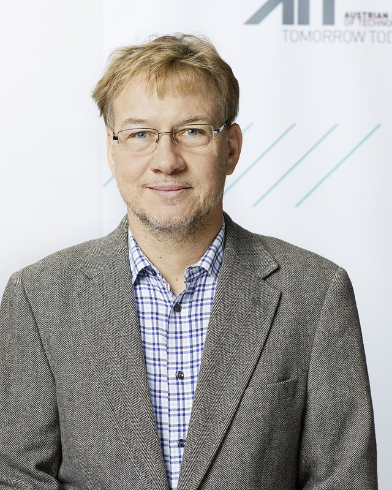

I am a trained physicist (PhD in computational physics) and systems modeller at [AIT Austrian Institute of Technology](https://www.ait.ac.at/) in Vienna. After about twenty years in industry – software development, European research projects and the leadership of international teams – I have worked since 2019 on climate impacts, adaptation and mitigation in urban and regional systems. My focus is on system dynamics (SD) modelling and its interfaces to climate and sector models for energy, transport and other domains, and on turning modelling results into decision support for stakeholders.

Contact: <martn.zach@gmail.com> · [ORCID 0000-0002-6487-1468](https://orcid.org/0000-0002-6487-1468) · [LinkedIn](https://www.linkedin.com/in/martin-zach-571bb56) · [GitHub](https://github.com/martnzach-wq) · [Publications](publications.qmd) · [Kurzprofil (Deutsch)](#kurzprofil)

## Research experience

**Research Engineer / Senior Researcher**, AIT Austrian Institute of Technology, Center for Energy (until 2020: Center for Mobility Systems) · since 2019

*Climate impacts, adaptation and mitigation*

- **[KNOWING](projects/knowing.qmd)** (Horizon Europe, 2022–2026) – lead of WP2 *Develop Modelling Framework* and member of the coordination team. Architecture and implementation of the Impact Interaction Model Framework: an SD framework with interfaces to more than ten domain models (regional climate, climate hazards, energy, transport and others), stepwise cross-calibration against domain model results, and concepts for backcasting and transferability. The SD models are open source.
- **[SHINE](projects/shine.qmd)** (ACRP, 2026–2028) – support of the impact model (systemic modelling). Heat impacts on mobile long-term care in Vienna and the effect of organisational and urban adaptation, in particular greening.
- **[GREENGAGE](projects/greengage.qmd)** (Horizon Europe, 2023–2025) – task lead. Systems-thinking approach to a governance model for citizen-based co-creation of urban climate policies.
- **[check4zero](projects/check4zero.qmd)** (FFG / BMIMI, 2024–2025) – project lead. Concept and prototype of a low-threshold decision-support tool for prioritising mobility measures in climate-neutral cities, developed with three Austrian cities.

*Systems analysis of mobility and transport*

- **[SASMAP-15mC](projects/sasmap.qmd)** (Driving Urban Transitions, 2025–2028) – lead of WP2. Qualitative systems analysis of shared mobility in 15-minute cities, with causal loop diagrams developed through group model building in Graz, Bristol and Helsingborg.
- **[BERTHA](projects/bertha.qmd)** (Horizon Europe, 2023–2026) – task lead for driver characterisation and acceptance testing: survey of about 4,700 drivers in five countries, data-driven driver typology, acceptance tests at three sites with 88 participants and almost 2,800 trials.
- **[LEVITATE](projects/levitate.qmd)** (Horizon 2020, 2019–2022) – work package lead and AIT lead. SD model for forecasting the societal impacts of connected and automated vehicles, integrated into a web-based policy support tool for cities.
- **[MultimoOpt](projects/multimoopt.qmd)** (VIF 2017, 2018–2020) – project lead. Park & Ride management solution with real-time information and reservation app, based on a survey of user types and a model-based location analysis; piloted at Stockerau station.

**Research Assistant / Postdoctoral Research Fellow**, Institute for Nuclear Physics, TU Wien · 1995–1998

- Large-scale Monte Carlo lattice simulations of quark confinement (U(1) and SU(3) lattice gauge theory); about 15 journal articles.
- Teaching of exercises and tutorials in theoretical physics.

## Industry experience

**Community Lead / Global Centre of Competence Head**, Siemens Convergence Creators (from 2018 Atos Convergence Creators), Vienna · 2015–2018
: Delivery and operations responsibility for R&D and customer projects; globally distributed teams in Austria, Slovakia, Croatia, China and India.

**Researcher and Solution Architect**, Siemens AG Austria / Siemens Convergence Creators, Vienna · 2004–2018
: Project lead and architecture work package lead in the EUREKA Celtic research projects MADEIRA and MAGNETO (autonomic network management); representative in the Celtic-Plus Core Group.

**Software / Systems Engineer and Development Project Manager**, Siemens AG Austria, Vienna · 1998–2004
: Requirements engineering for ESA Galileo Phase C0; software development in C++ and Java.

## Education

**PhD in Technical Sciences (Dr. techn.)**, TU Wien · 1995–1997
: Thesis: *Confinement in dually transformed U(1) lattice gauge theory*

**MSc (Dipl.-Ing.) in Technical Physics**, TU Wien · 1987–1994
: Thesis: *Duales Supraleitungsbild in der kompakten Gitter-QED*

## Methods and skills

- **Modelling:** system dynamics (qualitative and quantitative), causal loop diagrams, interface design between models, cross-calibration and validation, scenario and policy analysis, Monte Carlo simulation
- **Stakeholder processes and policy:** group model building, facilitation of workshops with cities and stakeholders (SASMAP-15mC, check4zero), policy briefs (KNOWING and NEVERMORE)
- **Data and statistics:** survey design and analysis, clustering, discrete-choice modelling, non-parametric testing
- **Programming:** Python (pandas, NumPy, pyam), C++, Java – code on [GitHub](https://github.com/martnzach-wq) and in the [projects overview](projects/index.qmd#code-and-software)
- **Modelling tools:** Vensim
- **Research management:** project, work package and task leadership, consortium coordination, proposals for Horizon Europe and national programmes (FFG, ACRP); reviewer for the International System Dynamics Conference (2025); member of the System Dynamics Society
- **Languages:** German (native), English (C1/C2), Russian (A2)

## Kurzprofil (Deutsch) {#kurzprofil lang="de"}

Ich bin ausgebildeter Physiker (Dr. techn., TU Wien) und arbeite seit 2019 am AIT Austrian Institute of Technology in Wien. Im Mittelpunkt meiner Arbeit stehen System-Dynamics-Modelle zu Klimafolgen sowie zu Anpassungs- und Klimaschutzmaßnahmen in Städten und Regionen, mit Schnittstellen zu Energie- und Verkehrsmodellen. Ich leite Arbeitspakete in EU-Projekten (KNOWING, SASMAP-15mC), habe nationale Projekte wie check4zero gemeinsam mit österreichischen Städten geleitet und arbeite im ACRP-Projekt SHINE an der Modellierung von Hitzeauswirkungen auf die mobile Langzeitpflege in Wien mit. Davor war ich rund 20 Jahre bei Siemens bzw. Atos in Softwareentwicklung, Lösungsarchitektur und der Leitung internationaler Teams tätig.
