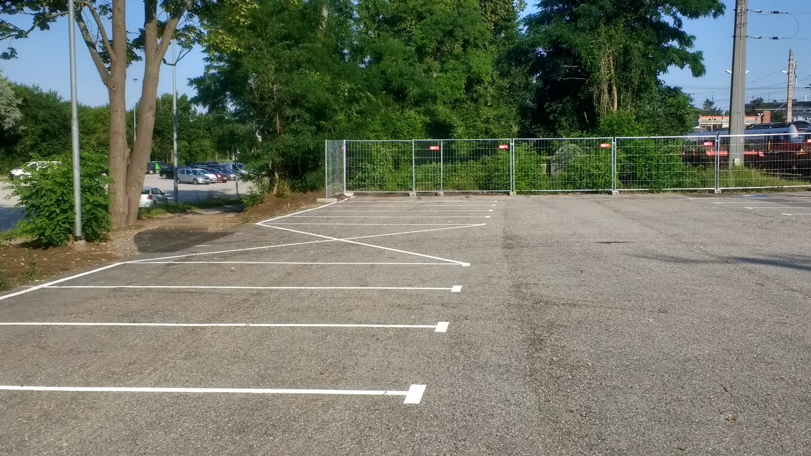

The pilot operation of the [MultimoOpt](../../projects/multimoopt.qmd) Park & Ride management solution at Stockerau station has been successfully completed. From February to June 2020, commuters could check the current status of the P+R facility in a mobile app and reserve a parking space; entry and exit were handled by a barrier system with number plate recognition.

{fig-alt="Newly marked parking spaces at the fenced Park and Ride pilot facility next to Stockerau railway station."}

The pilot started under normal conditions, and the new facility was well used. From mid-March, the COVID-19 measures emptied Park & Ride facilities across the region, although a few regular users stayed with the pilot throughout. The evaluation combines number plate data from before and after the implementation, the use of the app by the test persons, the effects of incidents on the road network, and user feedback.

## Die Presse on MultimoOpt

On 5 June 2020, *Die Presse* reported on the project under the title [„Neue Ideen, um Autofahrer für Bahnfahrten zu motivieren"](https://www.diepresse.com/5820374/neue-ideen-um-autofahrer-fuer-bahnfahrten-zu-motivieren). The article describes how drivers are told directly how much time they can gain by switching to the train, how many parking spaces are free and when the next train leaves. It also explains the user types identified in the project's survey, which are best reached through different information channels – from variable message signs on the motorway to the smartphone app.

## Next steps

The results and recommendations from the pilot – on the criteria that make people use Park & Ride, on suitable locations and on the practical implementation – are summarised in the project's final report. The prototype can be transferred to further sites.
