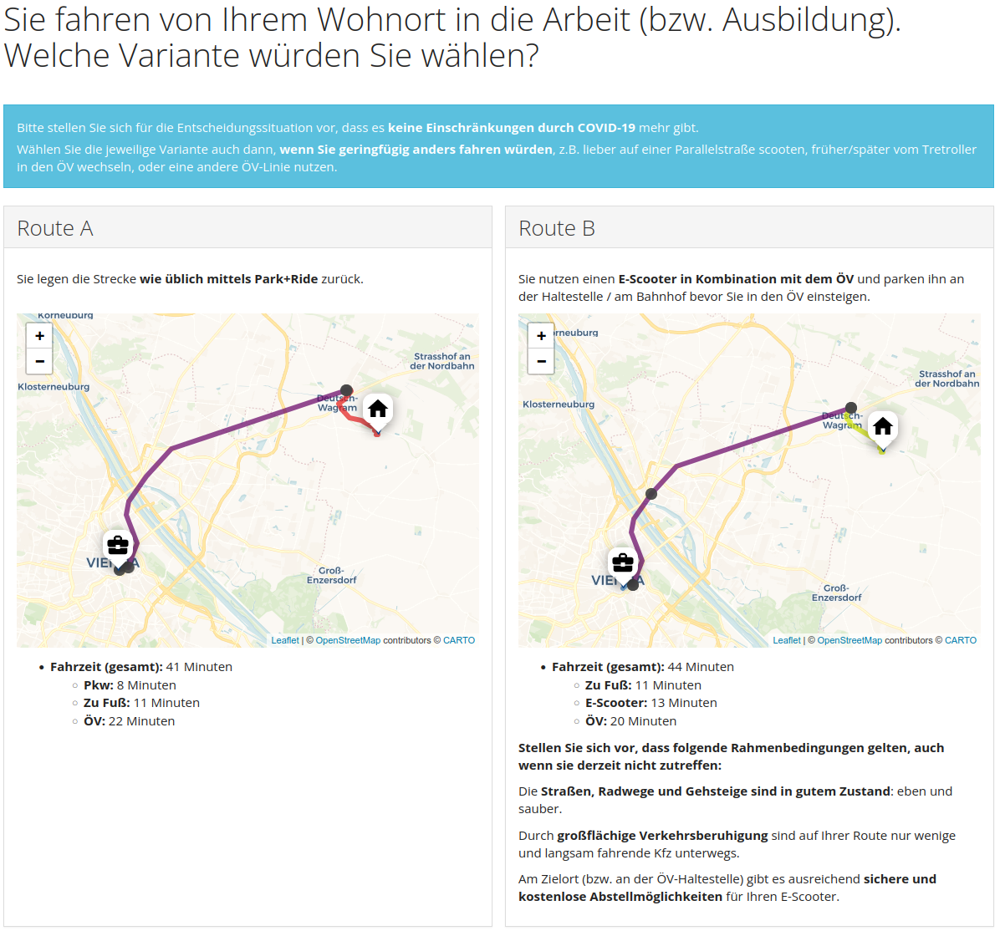

On 14 December 2021, the project team of [Scoot & Ride](../../projects/scootride.qmd) – AIT, con.sens mobilitätsdesign and Snizek + Partner – presented the project results to stakeholders in an online session, followed by questions and discussion. The project examined how far small vehicles such as kick scooters and e-scooters can act as a catalyst for shifting everyday trips to public transport, walking and cycling.

## What was presented

The presentation followed the four steps of the project:

- **State of research:** an international literature review on mobility behaviour, regulation and safety of (e-)scooters.
- **Analysis of measures:** a catalogue of 21 measures, assessed against criteria such as multimodality, road safety and conflicts with pedestrians, and grouped into options for the legislator and for municipalities.
- **Preference survey:** 382 participants recorded their usual trips in AIT's MyTrips tool and chose between their current route and a calculated alternative with kick scooter or e-scooter under the proposed measures.
- **Impact assessment:** a mode choice model applied to a synthetic population for Vienna and Lower Austria, with case studies for Pressbaum and Vienna-Donaustadt and a cost estimate of the infrastructure measures.

{fig-alt="Screenshot of the MyTrips survey with two route maps side by side, comparing the current trip with an alternative route using an e-scooter."}

## Key findings

- The willingness to switch was highest from public transport (30–40% of respondents chose the alternative), especially for trips of up to 20 minutes. From the car, just over 20% switched to (e-)scooters.
- Infrastructure – cycle paths, wider pavements and parking at public transport stops – matters more than the option of taking scooters on board.
- Kick scooters, which are cheap and already available in many households, have a shift potential of their own.
- In the case studies, packages of measures together with higher scooter ownership and e-scooter sharing raised the scooter share of trips, e.g. in Pressbaum from 1.4% without measures to up to 3.1%.

The [final report (German, PDF)](https://www.ait.ac.at/fileadmin/mc/energy/downloads/SBC/Project_pictures/Scoot_Ride/AIT-Report-S_R-Einzelseiten.pdf) summarises all results and eight recommendations.
