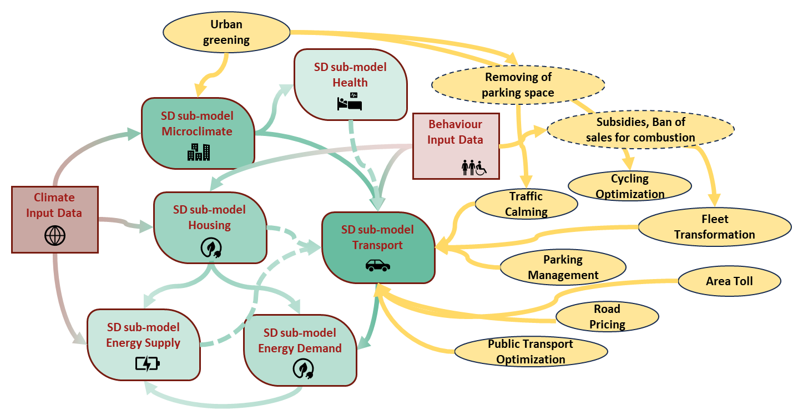

The final event of the Horizon Europe project [KNOWING](https://knowing-climate.eu/) took place on 29 April 2026 at the House of Music in Vienna, on site and online. Regional and municipal practitioners, policymakers and researchers discussed how climate modelling and local knowledge can be combined into integrated pathways for adaptation and mitigation in the four demonstrator regions Granollers (Spain), Naples (Italy), South Westphalia (Germany) and Tallinn (Estonia).

## The KNOWING modelling framework

As lead of work package 2, I presented the KNOWING modelling framework together with Paolo Scussolini (VU Amsterdam) in the session *Developing the pathways*. The framework addresses a gap in current modelling practice: climate impacts, adaptation measures and mitigation measures interact across sectors, but are usually assessed in separate models.

The framework combines two types of models:

- **Domain models** quantify the relationships within one sector at high spatial resolution, e.g. urban microclimate (PALM-4U), river and compound flooding, land use and transport.
- **System dynamics (SD) sub-models** for energy supply, energy demand and housing, microclimate, health, transport and behaviour are coupled through explicit cross-links. Interventions – from urban greening and parking management to road pricing, building refurbishment, heat pumps and PV – enter the SD model as policy levers.

{fig-alt="Diagram of coupled SD sub-models for microclimate, health, housing, transport, energy supply and energy demand, with interventions such as urban greening, parking management, area toll and road pricing."}

The SD sub-models are calibrated against the results of the domain models and are simplified accordingly, with a coarser spatial resolution. In return, they add what the domain models cannot provide on their own:

- development over the complete time range, i.e. **pathways** rather than single snapshots,
- quick modification of individual interventions in intensity and timing,
- the connection of the domains, which makes **response risks, co-benefits and trade-offs** between adaptation and mitigation visible,
- policy optimisation methods applied to the overall model, and
- re-running the model with adjusted inputs for other regions, which supports **transferability**.

Selected results showed how the transport and behaviour sub-models evolve over time and how the coupled sub-models add up to total greenhouse gas emissions for an optimised pathway compared with business-as-usual. In Granollers, for example, the integrated model reduces total emissions by 93% between 2019 and 2050 when all interventions are fully implemented.

## The rest of the programme

The demonstrator regions presented their challenges and results, from heat stress in Tallinn to river flooding in Granollers, forest dieback in South Westphalia and compound flooding in Naples. Further sessions covered the transferability of pathways to other European regions and the project's tools: the Decision Support System, the KNOWING Knowledge Base, the *Shape Your Future* app and the Playful Trainings.

## Further reading

- [KNOWING project website](https://knowing-climate.eu/)
- [Report on the final event, *Open Access Government*](https://www.openaccessgovernment.org/knowing-how-to-navigate-towards-climate-neutral-resilient-regional-future/209413/)
- [Integrated SD model for Granollers on GitHub](https://github.com/martnzach-wq/KNOWING-integrated-SD-model)
