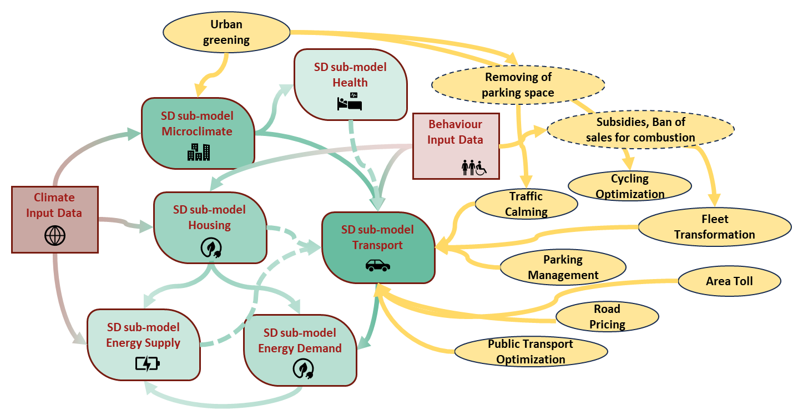
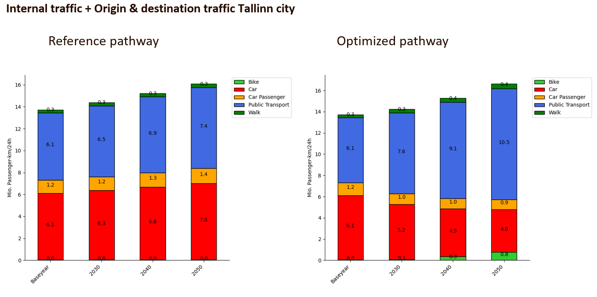

At the Transport Research Arena (TRA) 2026 in Budapest (18–21 May), I presented the paper *Modelling climate-resilient transport futures: a hybrid approach across urban and rural regions*, written with Benjamin Kokoll and Christian Rudloff. The work was carried out in the Horizon Europe project [KNOWING](../../projects/knowing.qmd) and covers three of its demonstrator regions: Tallinn, Naples and South Westphalia.

## A hybrid modelling approach

Detailed transport models represent mode and destination choice well, but they are run for a few points in time and do not capture interactions with other domains. System dynamics (SD) models address this gap. The paper combines both approaches:

- A **tour-based transport model** evaluates policy scenarios for each region. Interventions are translated into model parameters that increase over time – for example road capacity reductions for traffic calming, higher parking costs, an area toll, road pricing per kilometre, and improvements for cycling and public transport.
- An **SD model** is cross-calibrated against the results of the transport model. It uses a simplified spatial structure with a few zones and trip length classes, but adds the dynamics over the full time range up to 2050, rapid testing of timing, intensity and combinations of interventions, and the links to urban planning, microclimate, energy demand and supply, and behaviour.

{fig-alt="Diagram of coupled SD sub-models (microclimate, health, housing, transport, energy supply, energy demand) with climate and behaviour inputs and interventions such as urban greening, parking management, area toll and road pricing."}

{fig-alt="Stacked bar charts of passenger-kilometres by bike, car, car passenger, public transport and walking for 2030, 2040 and 2050 in the reference and optimised pathways."}

## Conclusions

- **Car pricing is the dominant lever for modal shift.** In all three regions, road pricing and parking charges reduce car use more than land-use and service-planning measures.
- **Active policy intervention is essential.** The business-as-usual pathways show no meaningful change in modal split.
- **CO₂ reductions depend on both electrification and demand management.** Modelling the uptake of electric vehicles endogenously gives additional insights.
- **Cross-domain interactions create both risks and co-benefits.** Urban greening linked to parking removal and traffic calming reduces local heat islands – a synergy between transport decarbonisation and climate adaptation.
- The simplified SD structure supports the **transfer** of pathways to other European regions with comparable characteristics.

## Paper

Zach, M., Kokoll, B., Rudloff, C. (2026). Modelling climate-resilient transport futures: a hybrid approach across urban and rural regions. In: *TRA Conference 2026*, Lecture Notes in Mobility, Springer. [doi:10.1007/978-3-032-37170-6_145](https://doi.org/10.1007/978-3-032-37170-6_145)
