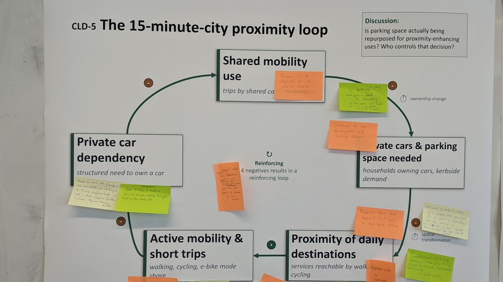

Between July and September 2026, SASMAP-15mC held its first round of stakeholder workshops in the three case cities: Bristol (7 July), Graz (8 July) and Helsingborg (24 September). The workshops are part of work package 2, the qualitative system analysis of car sharing in the context of the 15-minute city.

{fig-alt="Printed causal loop diagram with orange, green and yellow sticky notes from workshop participants."}

## The problem behaviour

The starting point is a twofold pattern observed in many cities. Car sharing is adopted only slowly. And where it is used, private car ownership does not necessarily decline: households keep their cars, and the modal split barely moves. The workshops explored which feedback structures might explain both parts of this behaviour.

## Approach

For each city, a set of simplified causal loop diagrams (CLDs) was printed as posters – for example on adoption and availability, cost comparison, proximity, parking, equity and exclusion, and care and carrying. Participants from city administrations, car sharing and micromobility operators, energy agencies, consultancies and research partners discussed the loops, corrected links and added missing variables. In total, 194 annotations were collected (Bristol 75, Helsingborg 73, Graz 46). Each annotation is recorded with what was said and what it changes in the diagram.

## First observations

- **Freed space is not automatically proximity.** In Graz and Bristol, participants independently replaced the link from fewer parked cars to more local destinations with an explicit allocation decision. Freed space is claimed by competing uses – climate adaptation, green infrastructure, bike parking or trees.
- **The effect acts on purchases, not on the car stock.** A Graz car sharing operator reported that the service replaces the purchase of a first or second car. Avoided purchases leave no trace in motorisation statistics for years, which explains part of the delay between car sharing use and visible changes in car ownership.
- **Car sharing replaces the second car.** In Helsingborg, operators observed that car sharing mainly replaces the household's second car. Parking is abundant and inexpensive there, which limits levers based on parking.
- **Coverage decides.** Operators in all cities stressed that car sharing needs sufficient geographic coverage to build a customer base.

## The consolidated diagram

The workshop results and further evidence were consolidated into one diagram with 91 variables, 103 causal links and 23 feedback loops: 11 loops from the entry-level set discussed in the first round and 12 added in the refinement. Select a loop in the list to highlight its path; drag to pan and scroll to zoom.

```{=html}
<div style="position:relative;width:100%;height:720px;border:1px solid var(--mz-rule);border-radius:8px;overflow:hidden;margin:1rem 0">
<iframe src="../../assets/interactive/sasmap-cld.html" title="SASMAP-15mC consolidated causal loop diagram" style="width:100%;height:100%;border:0" loading="lazy"></iframe>
</div>
```

[Open the diagram in full screen](../../assets/interactive/sasmap-cld.html). The diagram corresponds to the consolidated loop set reported in deliverable D2.1.

## Next steps

The consolidated diagram feeds the second workshop round, in which the proposed loops will be tested with stakeholders, and the identification of leverage points for the modelling and co-design work packages.

## Further reading

- [SASMAP-15mC on the DUT Partnership website](https://dutpartnership.eu/projects/sasmap-15mc)
- [Project introduction on the UWE *Transport and Society* blog](https://blogs.uwe.ac.uk/transport-and-society/?p=487)
