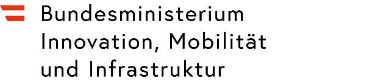

Cities and municipalities often find it difficult to compare the effects of mobility measures on the way to climate neutrality and to prioritise them, because detailed data and transport models are not available everywhere. check4zero developed the building blocks for a low-threshold, comparative impact assessment.

- **Knowledge base:** sustainability indicators for evaluating transport policy measures, with data requirements and data sources at district and city level; types of measures and their local feasibility; existing assessment methods and tools, summarised in eleven profiles.
- **Stakeholder process:** analysis of current processes and support needs in three Austrian cities of different size – Linz, Dornbirn and Gratwein.
- **Tool concept and mock-up:** a concept for quick, replicable impact assessment with minimal input data, and a mock-up for qualitative and semi-quantitative assessment, tested by the cities themselves.
- **Simplified system dynamics approach:** a model that captures the direction and order of magnitude of interactions between measures and indicators – conflicts as well as synergies – from a minimum of local data.

Together with the results of the project LMI-Sustain, check4zero provides a basis for a future tool available to all Austrian cities and municipalities.

::: {.mz-facts}
Funding
: FFG, FTI-Schwerpunkt Mobilitätswende (call "Mobilität 2023: Urbane Mobilität und Fahrzeugtechnologien"), funded by the Federal Ministry of Innovation, Mobility and Infrastructure (BMIMI)

Duration
: March 2024 – February 2025

Coordinator
: AIT Austrian Institute of Technology

Partners
: Grazer Energieagentur, Rupprecht Consult, Umweltbundesamt (Environment Agency Austria)

My role
: Project lead

Results
: [Final report (German, PDF)](https://projekte.ffg.at/anhang/6819f428eeb71_check4zero_Ergebnisbericht_1.1.pdf) · [FFG project database](https://projekte.ffg.at/projekt/5120811)
:::

{width=230px fig-alt="Bundesministerium Innovation, Mobilität und Infrastruktur"} {width=140px fig-alt="FFG"}

## Related notes
