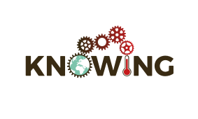

{width=200px fig-alt="KNOWING logo"}

KNOWING (*Framework for defining climate mitigation pathways based on understanding and integrated assessment of climate impacts, adaptation strategies and societal transformation*) developed a modelling framework that quantifies the interactions between climate impacts, adaptation strategies and mitigation pathways. Pathways were co-created with stakeholders in four demonstrator regions: Granollers (Spain), Naples (Italy), South Westphalia (Germany) and Tallinn (Estonia).

::: {.mz-facts}
Funding
: Horizon Europe, grant agreement [101056841](https://cordis.europa.eu/project/id/101056841)

Website
: [knowing-climate.eu](https://knowing-climate.eu/)

My role
: Lead of work package 2 (modelling framework) and member of the coordination team; lead author of D2.4 *Expandable Impact Interaction Model Framework*; system dynamics modelling for the Granollers demonstrator

Model
: [Integrated SD model on GitHub](https://github.com/martnzach-wq/KNOWING-integrated-SD-model)
:::

{width=220px fig-alt="Funded by the European Union"}

## Related notes
